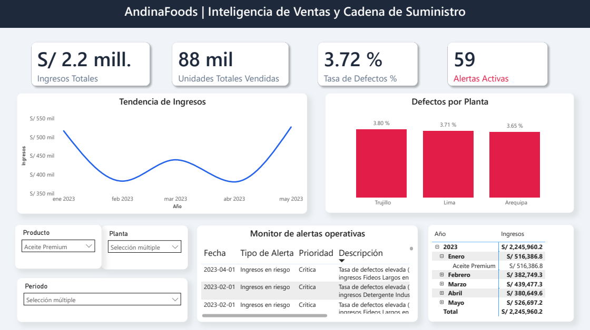

# AndinaFoods: Supply Chain & Sales Intelligence

An end-to-end data analytics and engineering project designed to monitor supply chain health by cross-analyzing sales performance and production defect rates.

##  The Business Problem
In manufacturing and retail, sales and production data are often siloed. This project solves that by integrating both domains into a single architecture, allowing stakeholders to detect when a high-selling product is experiencing abnormal defect rates in specific plants before it impacts the bottom line.

##  Architecture & Tech Stack
The project is built on a 3-tier architecture:

1. **Database (PostgreSQL):** 
   - Structured using a strict **Star Schema** to avoid Cartesian products. 
   - `products` acts as the dimension table, while `sales` and `production` act as the fact tables.
   - Includes data integrity constraints and analytical views (e.g., automated ranking using window functions).

2. **Data Pipeline (Python):**
   - Built with `pandas` and `SQLAlchemy`.
   - The master script (`run_pipeline.py`) orchestrates database teardown/setup, data ingestion, and cleaning.
   - **Alert Engine:** A custom logic evaluates merged operational data to detect multi-variable anomalies (e.g., Defect rate > 5% and Revenue < 500k), generating a `business_alerts.csv` log.

3. **Business Intelligence (Power BI):**
   - Connects directly to the PostgreSQL database.
   - Utilizes relational cross-filtering (via the `products` bridge table) to allow dynamic, synchronized filtering of both revenue and production defects without DAX workarounds.

## Power BI Dashboard



You can download the full interactive model in the [Power BI folder](./powerbi/SupplyChain_Dashboard.pbix).

You can also view the static exported report in PDF format [here](./docs/reporte_ejecutivo.pdf).

##  How to Run the Project

1. **Prerequisites:**
   - PostgreSQL installed and running (`localhost:5432`).
   - Python 3.8+ installed.

2. **Setup the Environment:**
   ```bash
   # Clone the repository
   git clone <your-repo-url>
   
   # Activate your virtual environment (if applicable)
   # Install requirements
   pip install -r requirements.txt